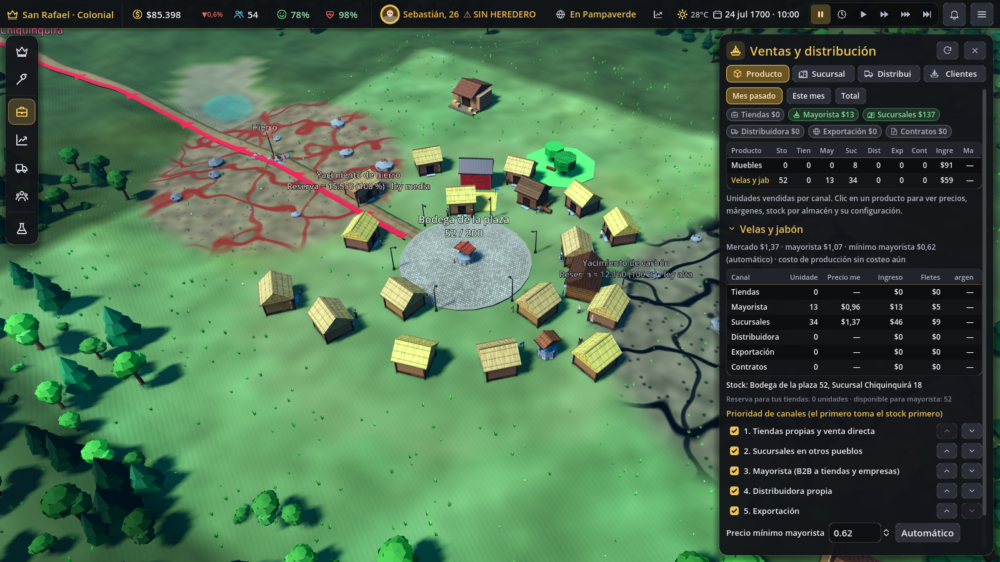
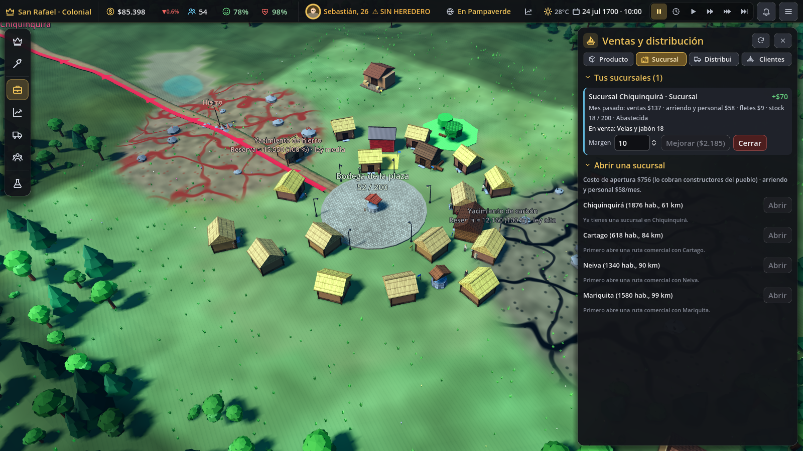

# Ventas y distribución: cómo se vende lo que fabricas

Pedido: "¿cómo se distribuye y se vende lo que fabrico? Debe haber buenas fuentes de ingreso."

Botón **Empresas → Ventas y distribución**. Configuración en `data/distribucion.json`; el negocio
Distribuidora está en `data/businesses_distribucion.json`. Estado en `GameState.market["distribution"]`
(se guarda con el mercado; las partidas viejas lo crean al cargar con valores por defecto).

## Canales de venta

| Canal | Quién compra | Precio | Qué necesita |
|---|---|---|---|
| **Tiendas propias** | Los vecinos, en tus comercios y en tus negocios que venden en su sitio | Tu precio (pestaña Precio) | Una tienda con personal |
| **Mayorista (B2B)** | Las tiendas NPC del pueblo (reponen su stock de reventa) y los comerciantes de los pueblos con ruta | Mercado × 0,78, nunca bajo el precio mínimo. La tienda NPC paga hasta mercado × 0,92; el pueblo paga su precio de importación × 0,8 | En el pueblo, nada. A otros pueblos: ruta **y** vehículo |
| **Sucursales** | Los vecinos de otro pueblo, al detalle | Precio de importación de ese pueblo × (1 + margen) | Ruta, vehículo para abastecerla, apertura ($900) y arriendo y personal mensual |
| **Distribuidora** | Lo mismo que el mayorista, a través de tu negocio Distribuidora | Su costo × (1 + su margen), con tope en lo que paga el cliente | El edificio con empleados (su flota) |
| **Exportación** | Compradores de fuera de la región | Mercado × 0,62 | Una ruta a otro pueblo o un puerto con personal, y un vehículo |
| **Contratos** | Los contratos firmados (`ContractSim`) | El precio fijo del contrato | Solo aparece en las estadísticas |

El precio mayorista siempre es menor que el minorista: así la tienda NPC gana al revender (compra a 0,78 y
vende a mercado + su margen de 2 % a 15 %).

## Demanda real: las tiendas NPC reponen

- Las **tiendas NPC** son las empresas NPC cuyo tipo es un comercio de `data/shops.json` (la Tienda general vende
  velas y jabón, loza, utensilios, pan, conservas, periódicos, papel, carbón, ropa y herramientas).
- Cada semana cada una pide lo que necesita para cubrir **14 días** de su demanda:
  - lo que vendió el mes pasado (o el ritmo de este mes), más 10 %;
  - más el 60 % de lo que los vecinos buscaron y no encontraron el mes pasado (`ShopSim`: "no hay tienda" o
    "sin existencias"), repartido entre las tiendas que venden ese bien.
- Paga de su caja: como mucho la mitad por semana. La mercancía queda en su **stock de reventa**
  (`b["resale"]`), aparte de su inventario. Así no se consume como insumo.
- Los vecinos le compran en `ShopSim` (los deseos semanales: ropa, velas, muebles…), igual que en tus tiendas, al
  precio de mercado + su margen y nunca bajo su costo.
- Si vendes al por mayor algo que los vecinos buscan y **ninguna tienda NPC lo revende**, un vecino con ahorros
  abre una Tienda (como mucho una cada 120 días, desde el mes 4, con las reglas de apertura de `NpcBusinessSim`).
- Los **comerciantes de otros pueblos** compran cada mes hasta el 35 % de la demanda del pueblo (filas de
  `TradeSim`). Pagan desde la caja del pueblo, a la llegada; si no les alcanza, la mercancía que no pagan
  vuelve a la bodega de la plaza. Lo que les vendes satura su precio (`sat`), como en Comercio exterior.

## Prioridad, canales y precio mínimo (por producto)

En la pestaña **Productos**, al elegir un producto:
- **Prioridad de canales** (flechas ↑ ↓): cada semana los canales toman el stock en ese orden. Por defecto:
  tiendas propias, sucursales, mayorista, distribuidora, exportación.
- **Canales activos** (casillas). La exportación empieza apagada.
- **Reserva de tus tiendas**: tus tiendas venden todo el tiempo. Si van antes que otro canal, ese canal deja
  21 días de lo que ellas venden (8 unidades si aún no hay historial).
- **Precio mínimo mayorista**: vale para mayorista, distribuidora y exportación. En 0 es automático:
  tu costo de producción del mes pasado (`CostSim`) + 5 %, o el 45 % del mercado si aún no hay costeo.
  Si el mínimo supera lo que pagan, no se vende y el panel lo avisa.

El panel muestra, por producto y canal: unidades, precio medio, ingreso, fletes y margen
((ingreso − fletes − unidades × costo de producción) ÷ ingreso), para el mes pasado, este mes o el total.
También el stock por almacén: bodegas, inventario de negocios, distribuidoras y sucursales.

## Transporte: sin ruta ni vehículo no llega

- A otro pueblo solo llega carga si hay **ruta comercial** (Comercio exterior) **y un vehículo** con espacio
  y alcance:
  - tus **estaciones de transporte** con personal (central de transporte, caballeriza, depósito de camiones…):
    capacidad por semana = trabajadores × 30 × el multiplicador de su mejor medio (a pie 1, mulas 1,6,
    carretas 2,5, camiones 6, tren 10). Alcance: a pie 90 km, mulas 150 km, carretas 180 km, motor sin límite;
  - la **flota de tus distribuidoras** (ver abajo).
- **El transporte cuesta.** Cada viaje paga unidades × km × $0,004 + $1 (× nivel de precios) por combustible,
  forraje y desgaste. Lo paga el dueño del vehículo (libro "insumos") y lo cobran proveedores del pueblo;
  el 45 % es importado (`FlowSim.spend`, motivo «combustible y forraje (distribución)»).
- Si el vehículo es de tu **división de transporte**, el viaje pasa por `TransportDivSim.record_trip`: suma
  unidades·km para el reparto del costo entre tus negocios (división interna) o factura el flete al negocio
  que vende (empresa aparte). Los días de viaje salen de la distancia y la velocidad del medio.

## Sucursales (pestaña Sucursales)

- Se abren en un pueblo con ruta. La apertura ($900 × precios) la cobran constructores de ese pueblo (a su caja).
- Cada mes: arriendo + 1 empleado (nivel 1: $15 + 1 × $1,8 × 30) o 3 (nivel 2, "Almacén sucursal", con
  Contabilidad). Se pagan a la caja del pueblo.
- Se abastece sola cada semana (21 días de ventas, hasta su capacidad: 200 o 600 unidades), por la ruta y con
  tus vehículos.
- Vende cada día: demanda del pueblo (al menos 0,03 × habitantes al mes) × captura (0,6 o 1,1) × elasticidad
  al margen. El dinero sale de la caja del pueblo (hasta el 3 % por día).
- Margen ajustable (de −30 % a +80 %), mejorar y cerrar (la mercancía vuelve a la bodega de la plaza).

## Distribuidora (negocio nuevo)

Construir → Comercio → **Distribuidora**: de arrieros (sin tecnología), con carretas (Carretas) y centro de
distribución (Automóvil). Cada nivel trae su flota (unidades por semana por empleado: 35, 80, 220), su bodega
(400, 1.200, 4.000) y su alcance (90 km, 180 km, todo el país).
- **Compra a tus fábricas**: traspaso interno al precio mayorista. La fábrica registra la venta y la
  distribuidora la compra en su libro; el dinero no sale del grupo y el consolidado de Finanzas lo elimina.
- **Compra a empresas NPC** su excedente (lo que pasa de 10 días de ventas) a su precio × 0,85, y les paga de
  verdad (a su caja).
- **Vende** a las tiendas NPC del pueblo y a los comerciantes de los pueblos con ruta dentro de su alcance, con
  su flota, a su costo × (1 + margen, 12 % por defecto). Nunca vende a pérdida.
- Sin empleados no reparte. Cuenta para el límite de negocios de tu oficina.

## Economía cerrada

Todo pago tiene origen y destino:

| Movimiento | De → a |
|---|---|
| Venta mayorista local | Caja de la tienda NPC → tu negocio que fabrica el bien |
| Reventa a los vecinos | Ciudadano → caja de la tienda NPC |
| Venta a otro pueblo, sucursal | Caja del pueblo → tú (o tu distribuidora) |
| Apertura, arriendo y personal de la sucursal | Tú → caja del pueblo |
| Compra a una empresa NPC | Tu distribuidora → caja de la empresa NPC |
| Traspaso fábrica → distribuidora | Solo libros (no mueve dinero) |
| Transporte | Dueño del vehículo → proveedores del pueblo y cuenta externa (`FlowSim.spend`) |
| Exportación | Cuenta externa (`FlowSim.external_in`, motivo «exportación (distribución)») → tú |

Además, en este cambio los pagos que iban "a nadie" ahora tienen destino:
- **Logística** (`logistics_sim.gd`): surtidor (obras), forraje de los animales (`forraje`, 10 % importado),
  mantenimiento de vehículos, combustible (`combustible`, 70 % importado) y la compra automática de insumos a
  precio de importación (`FlowSim.spend_import`: el arancel al tesoro y el resto a la cuenta externa).
- **Transporte público** (`transit_sim.gd`): carreteras, paraderos y trazados a otros pueblos (obras; una
  rebaja por trazado más corto vuelve como `external_in`), compra de buses (80 % importado), mantenimiento y
  combustible.
- **Aviación** (`air_sim.gd`): ya tenía destino: el combustible y la tarifa de la aerolínea se registran en
  `CountriesSim.add_outflow` (cuenta externa). No se tocó para no contarlos dos veces.
- **Comercio exterior** (`trade_sim.gd`): rutas, mejoras de camino y vías (obras), mantenimiento mensual,
  el flete (lo que no son sueldos de cargadores del pueblo va a `FlowSim.spend`, motivo `fletes`), las
  compras a un pueblo (su caja cobra; el arancel al tesoro) y las ventas a un pueblo (paga su caja; si no
  alcanza, clientes de fuera por la cuenta externa).

`tests/test_conservacion.tscn` sigue en 0 y `tests/test_distribucion.tscn` verifica la conservación en cada canal.

## Archivos

| Archivo | Qué hace |
|---|---|
| `scripts/sim/distribution_sim.gd` | Canales, tiendas NPC, sucursales, distribuidoras, vehículos, viajes y estadísticas |
| `scripts/ui/distribution_panel.gd` | Panel Ventas y distribución |
| `data/distribucion.json` | Parámetros |
| `data/businesses_distribucion.json` | Negocio Distribuidora (3 niveles con modelo low-poly) |
| `tests/test_distribucion.gd` | Pruebas |
| `tests/screenshot_distribucion.gd` | Capturas de `docs/capturas/distribucion/` |

Ganchos en archivos compartidos:
- `FreeMarketSim`: `init_state`, `daily` y `monthly` llaman a `DistributionSim`.
- `ShopSim.context/_buy`: las tiendas NPC venden su stock de reventa; las ventas de tus tiendas se registran.
- `MarketSim.purchase/discretionary` y `WarehouseSim.shop_sell`: registran la venta directa (canal tiendas).
- `ContractSim.deliver`: registra el canal contratos.
- `TransportDivSim.record_trip` (nuevo, también lo usa su `daily`); el consolidado elimina los traspasos a la distribuidora.
- `FlowSim.share_of` y `FlowSim.spend_import` (nuevos); `economy.json → flows.import_share` con los motivos nuevos.
- `hud.gd`: entrada del menú y panel; `tests/ui_smoke.gd` abre Contratos y Ventas y distribución.

## Pruebas

`godot --headless tests/test_distribucion.tscn`:
configuración por producto; mayorista local (la tienda NPC compra, paga y revende a los vecinos); sin ruta y
sin vehículo no llega, con ruta y central sí (costo del flete y `TransportDivSim`); sucursal (apertura, abasto,
ventas, costos y cierre); distribuidora (traspaso interno, compra a empresas NPC y entrega a un pueblo);
exportación (cuenta externa); prioridad, reserva de tiendas, precio mínimo y canal apagado; pagos con destino de
logística, buses y comercio exterior; guardado y partida vieja; 3 años con todos los canales (conservación mes a
mes, ganancia y población); la interfaz.

## Riesgos y pendientes

- Las tiendas NPC solo existen si un vecino abre una; el mayorista local depende de ellas.
- La sucursal rinde poco con un solo producto barato: conviene con varios productos o bienes que el pueblo pide.
- Las cajas de los pueblos crecen despacio (15 % de su ingreso): limitan cuánto les puedes vender cada mes.
- La capacidad de las estaciones de transporte es una aproximación por trabajadores y mejor medio; no usa los
  viajes de vehículos concretos de Logística.
