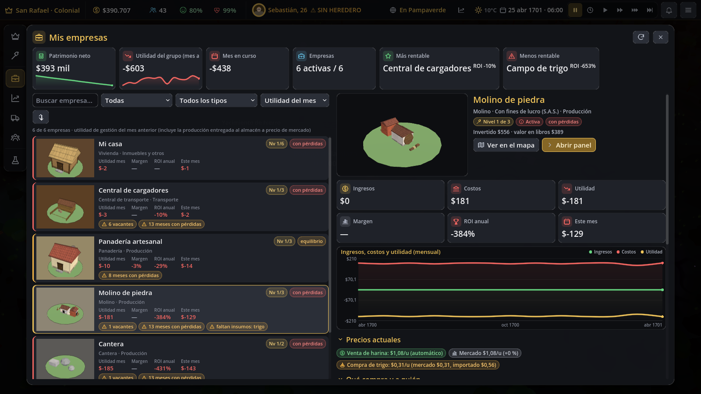
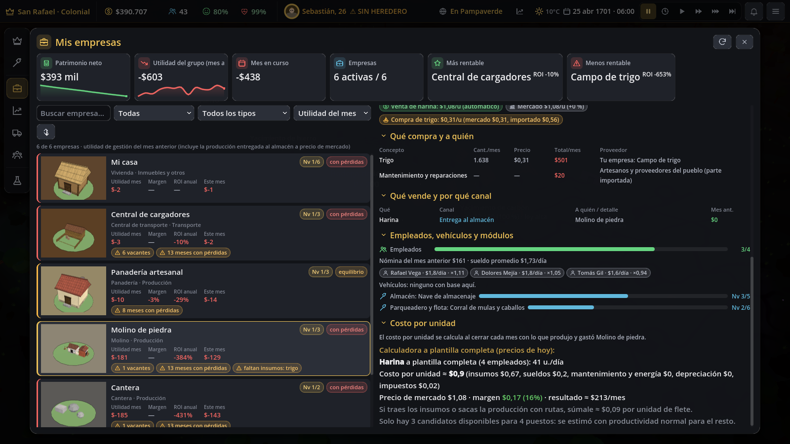
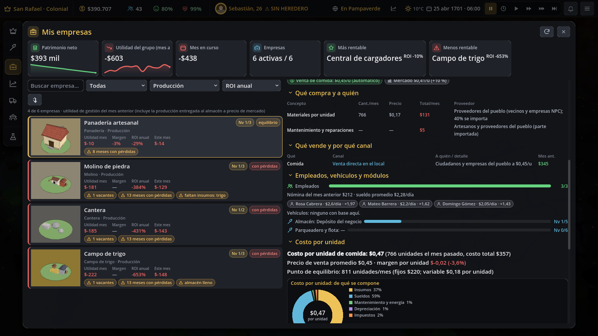
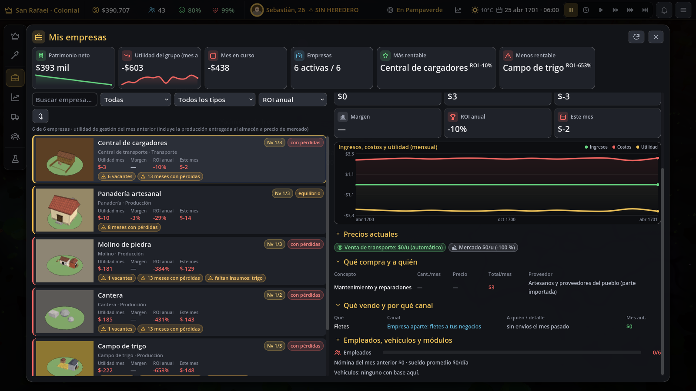

# Mis empresas

Pedido: una categoría «Mis empresas» en el HUD con la lista de todas tus empresas (foto 3D, nivel, estado,
utilidad, margen y ROI; ordenable y filtrable), una ficha por empresa y un resumen del grupo arriba.

Se abre con **Empresas (F2) → Mis empresas** o con la tecla **C** (la misma tecla la cierra, igual que Esc).
Es una ventana a pantalla completa, como «Mis terrenos».







## Para el jugador

### Resumen del grupo (arriba)
- **Patrimonio neto**: dinero + propiedades + cartera − deudas, con su tendencia de 24 meses.
- **Utilidad del grupo (mes anterior)**: el consolidado contable de todas tus empresas. No cuenta los fletes entre tus
  empresas ni la producción entregada al almacén, porque se contarían dos veces.
- **Mes en curso**: lo que llevas acumulado este mes.
- **Empresas** activas sobre el total (en el tooltip, los cupos de la oficina).
- **Más rentable** y **menos rentable**: se comparan por ROI anual. Si una empresa no tiene inversión registrada, se
  usa su margen. Haz clic en la tarjeta para ir a su ficha.

### Lista
- Cada tarjeta trae la **foto 3D del edificio** (el mismo modelo del mapa, con su nivel y sus módulos), el nombre,
  el nivel (actual/máximo), el estado (rentable, equilibrio, con pérdidas, en obra, cerrada, sin datos), el tipo, la
  **utilidad del mes anterior**, el **margen**, el **ROI anual**, lo que va del mes y alertas (vacantes, meses con
  pérdidas, almacén lleno o faltan insumos).
- **Ordenar** por utilidad, margen, ROI, ingresos, nivel o nombre. El botón ↓/↑ invierte el orden.
- **Filtrar** por estado (todas, rentables, con pérdidas, en obra o mejora, cerradas), por tipo (producción, comercio
  y servicios, transporte, inmuebles y otros) y por texto.
- Clic en una tarjeta abre su ficha. Doble clic abre el panel del edificio.

### Ficha
- **Visor 3D** girando, nombre, tipo, forma legal, nivel, estado, lo invertido y el valor en libros.
- Botones **Ver en el mapa** (cierra la ventana y lleva la cámara al edificio) y **Abrir panel** (el panel del
  edificio, con precios, personal y mejoras).
- Indicadores del mes anterior: ingresos, costos, utilidad, margen, ROI anual y el mes en curso.
- **Gráfica mensual** de ingresos, costos y utilidad (hasta 60 meses).
- **Precios actuales**: tu precio de venta frente al de mercado y el precio de compra de cada insumo (a tu costo si
  lo produces tú, de mercado o importado).
- **Qué compra y a quién**: cada insumo con su cantidad y costo por mes y su proveedor (tu fábrica que lo produce,
  ruta que lo trae o lo compra afuera, contrato de compra, importación automática, empresas NPC que lo producen o el
  mercado). También los materiales por unidad, el mantenimiento y la electricidad.
- **Qué vende y por qué canal**: entrega al almacén y de ahí a tus tiendas, contratos de venta, exportaciones o rutas
  a otra empresa tuya; venta directa en el local; fletes (internos o a clientes NPC); alquileres, intereses o
  subsidios. Cada canal trae lo facturado el mes anterior.
- **Empleados, vehículos y módulos**: plantilla y vacantes, nómina, sueldo promedio, los mejores empleados (sueldo y
  productividad), vehículos con base en el edificio y nivel de cada módulo (almacén, parqueadero y flota).
- **Costo por unidad**: la pestaña Costos (CostSim), con el desglose, el margen por unidad, el punto de equilibrio,
  el historial y la calculadora.

### Cómo se calcula la utilidad de una empresa
`utilidad = ingresos del libro + producción entregada al almacén (a precio de mercado) − costos del libro`.
Los costos son todo lo que no es ingreso ni inversión: sueldos, insumos, mantenimiento, fletes, impuestos, IVA,
multas y robos. Una fábrica que entrega al almacén no factura, porque la venta la registra la tienda, el contrato o la
exportación. Sin esa transferencia valorada parecería que siempre pierde.
- **Margen** = utilidad ÷ ingresos (incluida la transferencia).
- **ROI anual** = utilidad de los últimos 12 meses (o el promedio de los meses que haya × 12) ÷ lo invertido (las
  obras del edificio).

## Para desarrolladores

| Archivo | Contenido |
|---|---|
| `scripts/sim/company_report_sim.gd` | `CompanyReportSim`: filas, orden, filtros, resumen, historial, compras/proveedores, ventas/canales, personal, vehículos, módulos, costo por unidad y precios. Solo lee el estado. |
| `scripts/ui/my_companies_window.gd` | `MyCompaniesWindow`: la ventana (resumen, lista y ficha). Señales `open_building(id)` y `focus_building(id)`. |
| `scripts/ui/building_thumb.gd` | `BuildingThumb`: miniatura 3D de un edificio. `make(b, tamaño)` crea un visor en vivo. `request(host, b, tamaño, TextureRect)` hace una foto fija: la renderiza una vez en un SubViewport temporal (una por cuadro), la copia a una `ImageTexture` y la guarda en caché por modelo. |
| `tests/test_mis_empresas.gd` | Prueba (TODO OK) |
| `tests/screenshot_mis_empresas.gd` | Capturas en `docs/capturas/empresas/` |

### Estado nuevo
- Por edificio: `pnl_hist = [[día, ingresos, costos, transferido], …]`, hasta 60 meses. Lo escribe
  `CompanyReportSim.monthly` al cerrar el mes, desde `TerrenosCostosSim.monthly`, después de `CostSim`.
- **Partidas viejas**: sin `pnl_hist`, la gráfica arranca con el libro del mes anterior como único punto y el
  historial empieza en el siguiente cierre. No hay migración: todo lo demás se calcula del estado existente.

### Economía cerrada
La ventana y `CompanyReportSim` no mueven dinero. La transferencia al almacén solo se usa para mostrar el
resultado de cada empresa y no se suma al consolidado del grupo. La prueba verifica que `FlowSim.conserved_total` y
`GameState.money` no cambian al consultar todo ni al registrar el historial.

### Cambios en archivos compartidos
- `scripts/sim/terrenos_costos_sim.gd`: una línea (`CompanyReportSim.monthly(gs)`).
- `scripts/ui/hud.gd`: la variable `companies_window`, su creación y sus señales, y la entrada «companies» de
  `_item_active` y `_open_item`. Ahora el atajo C y el menú abren la ventana. El panel lateral anterior
  (`CompaniesPanel`) sigue existiendo para `_show_dock("companies")`, que usan `ui_smoke` y `screenshot_ui`.
- `docs/UI.md`: descripción de Mis empresas.

### Pruebas
```
godot --headless res://tests/test_mis_empresas.tscn
xvfb-run -a -s "-screen 0 1600x900x24" godot --rendering-driver opengl3 --resolution 1600x900 \
    res://tests/screenshot_mis_empresas.tscn -- docs/capturas/empresas
```
La prueba cubre:
- Las filas: utilidad = ingresos + transferencia − costos, margen y ROI.
- La transferencia del trigal = unidades × precio.
- El historial y su tope de meses.
- Los seis órdenes en las dos direcciones y los filtros por tipo, estado y texto.
- El resumen: patrimonio, consolidado, y que la más rentable y la menos rentable sean los extremos.
- Compras y proveedores (el molino le compra a tu trigal), canales de venta, precios, personal, módulos, vehículos,
  costo por unidad real y estimado, y una empresa nueva sin datos.
- Que el dinero no cambia.
- La ventana: tarjetas con foto, orden, filtro, búsqueda, visor en vivo, gráfica, secciones y los botones de mapa y
  panel.
- La integración con el HUD.
- Guardar y cargar, y una partida vieja.
